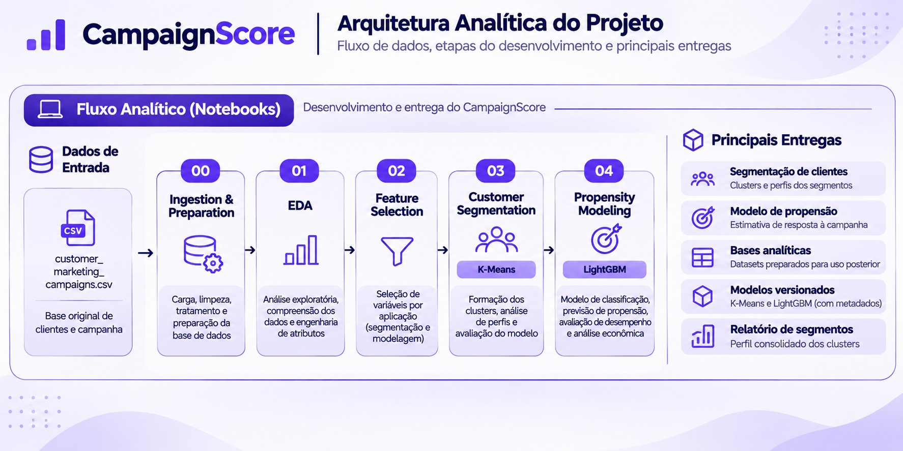

# CampaignScore

*Modelagem de propensão e priorização de campanhas de marketing.*


O **CampaignScore** é um case de Machine Learning integrante do projeto **CRM Intelligence**.Seu desenvolvimento foi inspirado em um desafio técnico de processo seletivo na área de dados aplicada a CRM, proposto por uma empresa brasileira do segmento de delivery de alimentos.

O cenário representa uma empresa fictícia do varejo alimentício que busca melhorar a rentabilidade de suas campanhas de marketing direto. Uma campanha piloto, realizada com 2.240 clientes, apresentou taxa de conversão de aproximadamente 15%. A receita gerada foi inferior ao custo da ação, resultando em um saldo negativo de **3.046 unidades monetárias (MU)**.

Esse resultado motivou a busca por uma abordagem orientada por dados, capaz de identificar clientes com maior **propensão a aceitar ofertas** e direcionar os esforços de marketing de maneira mais eficiente. O objetivo central do case é desenvolver soluções analíticas que contribuam para melhorar a rentabilidade das campanhas.

Os dados utilizados são públicos e representam o cenário fictício proposto no desafio. Não correspondem a registros reais de clientes da empresa que o inspirou.

---

## 1. O que foi construído

O case percorre o desenvolvimento de soluções analíticas para compreender o comportamento dos clientes e apoiar a priorização de campanhas.

- **Customer Segmentation:** identificação de perfis de clientes por meio de técnicas de agrupamento.
- **Propensity Modeling:** estimativa da propensão individual de resposta a campanhas, utilizando LightGBM.
- **Economic Evaluation:** avaliação da estratégia de priorização considerando custos de contato e receita associada às conversões.

As etapas de preparação, exploração e seleção de variáveis fornecem a base para o desenvolvimento e a avaliação dessas soluções.

## 2. Arquitetura



A arquitetura organiza o percurso entre os dados de origem, a preparação analítica, o desenvolvimento dos modelos e a geração dos resultados. Os artefatos produzidos incluem bases processadas, atribuições de segmentos, modelos treinados e relatórios de apoio à análise.

## 3. Fluxo de desenvolvimento

O desenvolvimento foi organizado em cinco notebooks, com responsabilidades distintas:

| Notebook | Etapa |
|---|---|
| [`00-ingest_prep`](notebooks/00-ingest_prep.ipynb) | Preparação e tratamento dos dados |
| [`01-eda`](notebooks/01-eda.ipynb) | Análise exploratória |
| [`02-feature-selection`](notebooks/02-feature-selection.ipynb) | Construção e seleção de variáveis |
| [`03-customer-segmentation`](notebooks/03-customer-segmentation.ipynb) | Segmentação de clientes |
| [`04-propensity-modeling`](notebooks/04-propensity-modeling.ipynb) | Modelagem de propensão e avaliação econômica |

## 4. Resultados e principais achados

### Segmentação de clientes

A segmentação com K-Means identificou três perfis entre os **2.229 clientes** utilizados na modelagem. A caracterização considera as variáveis em suas unidades originais:

| Perfil | Clientes | Renda média (MU) | Consumo médio (MU) |
|---|---:|---:|---:|
| Baixo consumo | 894 (40,11%) | 32.506 | 74,69 |
| Alto consumo multicanal | 671 (30,10%) | 73.863 | 1.285,40 |
| Consumo intermediário orientado a ofertas | 664 (29,79%) | 54.676 | 633,24 |

*Consumo médio corresponde à soma dos gastos médios nas seis categorias de produtos. A renda média considera somente os registros com renda disponível.*

Os grupos apresentam padrões distintos de consumo e relacionamento:

- **Baixo consumo:** reúne clientes com menor renda e volume de gastos. Apesar da baixa atividade de compra, registra a maior média de visitas mensais ao site (6,52), sem que esse interesse digital se traduza em consumo proporcional.
- **Alto consumo multicanal:** concentra os maiores níveis de renda e consumo, com maior frequência de compras em lojas físicas e por catálogo. Também apresenta as maiores taxas de aceitação das campanhas 1 (17,73%) e 5 (22,06%).
- **Consumo intermediário orientado a ofertas:** apresenta consumo intermediário, maior frequência de compras com desconto (3,93) e de compras pela web (5,95). Também registra a maior taxa de aceitação da campanha 4 (12,05%).

A escolha de **K=3** buscou oferecer maior granularidade para interpretar os perfis. As métricas internas de validação favoreceram K=2 nesta execução; portanto, a configuração adotada representa uma decisão de interpretabilidade, não uma superioridade estatística ou comercial comprovada.

### Modelagem de propensão

Foram comparados cinco algoritmos: Regressão Logística, KNN, Árvore de Decisão, XGBoost e LightGBM. Após a comparação inicial, Regressão Logística, XGBoost e LightGBM avançaram para otimização de hiperparâmetros.

A escolha do modelo considerou como critério principal o **lucro observado médio por 1.000 clientes** na validação cruzada. Os três candidatos apresentaram resultados próximos nesse indicador:

| Modelo | Lucro observado / 1.000 clientes | Lucro esperado / 1.000 clientes | Average Precision |
|---|---:|---:|---:|
| **LightGBM** | **588,85 MU** | 451,12 MU | 0,6586 |
| Regressão Logística | 587,77 MU | 595,23 MU | 0,6786 |
| XGBoost | 587,66 MU | 608,17 MU | 0,6709 |

O **LightGBM** foi selecionado por apresentar o maior lucro observado médio, embora sua vantagem tenha sido marginal. Regressão Logística e XGBoost obtiveram resultados superiores em lucro esperado e Average Precision. A decisão, portanto, reflete o critério econômico definido para o case, e não uma superioridade geral do LightGBM em todas as métricas.

No conjunto de teste, com 446 clientes, o modelo selecionado apresentou:

| Métrica | Resultado |
|---|---:|
| Average Precision | 0,6994 |
| ROC-AUC | 0,9178 |
| Brier Score | 0,0765 |
| Precision@10% | 73,33% |
| Recall@10% | 49,25% |

A análise de importância por permutação destacou `Recency`, `FamilyProfile`, `AcceptedCmp5`, `TenureDays` e `MntMeatProducts` como as cinco variáveis cuja permutação mais reduziu a Average Precision. Esse resultado indica dependência preditiva do modelo em relação a essas informações nesta amostra, não uma relação causal.

### Avaliação econômica

A simulação considerou custo de contato de **3 MU** e receita de **11 MU** por conversão. Com essas premissas, o ponto de equilíbrio corresponde a uma probabilidade estimada de resposta de **27,27%**.

No conjunto de teste, a estratégia selecionou 72 dos 446 clientes (16,14%). Entre os selecionados, 44 responderam, concentrando 65,67% das 67 respostas positivas existentes no conjunto:

| Indicador | Resultado |
|---|---:|
| Clientes selecionados | 72 |
| Taxa de resposta entre selecionados | 61,11% |
| Respostas positivas capturadas | 65,67% |
| Lucro esperado da estratégia | 179,24 MU |
| Lucro observado da estratégia | **268,00 MU** |
| Lucro observado com contato indiscriminado | **−601,00 MU** |

A simulação demonstra o potencial de concentrar os contatos em uma parcela menor da base, em vez de abordar todos os clientes indiscriminadamente. O resultado é válido para a amostra de teste e para as premissas econômicas adotadas no case.

## 5. Estrutura do projeto

```text
campaignscore/
├── assets/
│   └── campaignscore-arquitetura-readme.png
├── data/
│   ├── raw/
│   │   └── customer_marketing_campaigns.csv
│   └── processed/
│       ├── business_parameters.json
│       ├── customer_data.parquet
│       ├── customer_features.parquet
│       ├── customer_predictive.parquet
│       ├── customer_segment_assignments.parquet
│       └── customer_segmentation.parquet
├── models/
│   ├── predictive/
│   │   ├── lightgbm_classifier_v1.joblib
│   │   └── lightgbm_classifier_v1.metadata.json
│   └── segmentation/
│       ├── kmeans_v1.joblib
│       └── kmeans_v1.metadata.json
├── notebooks/
│   ├── 00-ingest_prep.ipynb
│   ├── 01-eda.ipynb
│   ├── 02-feature-selection.ipynb
│   ├── 03-customer-segmentation.ipynb
│   └── 04-propensity-modeling.ipynb
├── reports/
│   └── customer_segment_profile.csv
├── src/
│   ├── __init__.py
│   └── paths.py
├── pyproject.toml
├── uv.lock
└── LICENSE
```

## 6. Reprodução

O projeto utiliza Python 3.12 ou superior e o gerenciador de dependências `uv`.

Clone o repositório:

```bash
git clone https://github.com/smalldatalabbr/campaignscore
cd campaignscore
```

Instale as dependências:

```bash
uv sync
```

Inicie o JupyterLab:

```bash
uv run jupyter lab
```

Os notebooks estão organizados na sequência de desenvolvimento apresentada anteriormente.

## 7. Limitações e considerações

- **Cenário de negócio:** os resultados econômicos utilizam premissas simplificadas de custo por contato e receita por conversão.
- **Validação:** a avaliação foi realizada sobre uma amostra de teste, sem validação em campanhas reais ou mensuração de efeito incremental.
- **Segmentação:** a escolha de três grupos priorizou a interpretação e a granularidade dos perfis, embora as métricas internas tenham favorecido uma solução com dois grupos.

Os resultados devem ser interpretados como evidências obtidas no contexto do estudo, e não como garantia de desempenho ou rentabilidade em uma operação real.

## 8. Síntese do case

O CampaignScore demonstra como técnicas de segmentação e modelagem preditiva podem ser combinadas para transformar dados de clientes em critérios de priorização de campanhas. Mais do que estimar a probabilidade de resposta, o trabalho incorpora premissas econômicas à decisão, aproximando a modelagem de uma necessidade concreta do negócio.

O case entrega modelos treinados, bases processadas e artefatos de análise que estabelecem uma base técnica para futuras aplicações no contexto do **CRM Intelligence**.

## Tecnologias

* **Python 3.12+:** implementação do fluxo analítico e execução dos notebooks.
* **JupyterLab e uv:** ambiente de desenvolvimento e gerenciamento de dependências.
* **Pandas e NumPy:** manipulação de dados, operações numéricas e suporte aos cálculos analíticos.
* **PyArrow e Parquet:** leitura, gravação e armazenamento das bases processadas em formato colunar.
* **Scikit-learn:** preparação dos dados, segmentação, seleção de variáveis e avaliação dos modelos.
* **LightGBM:** modelagem preditiva de propensão à resposta.
* **XGBoost:** algoritmo alternativo utilizado na comparação de modelos.
* **Matplotlib e Seaborn:** visualização e exploração dos dados e resultados.

## Licença

Consulte o arquivo [LICENSE](LICENSE) para informações sobre a licença do projeto.